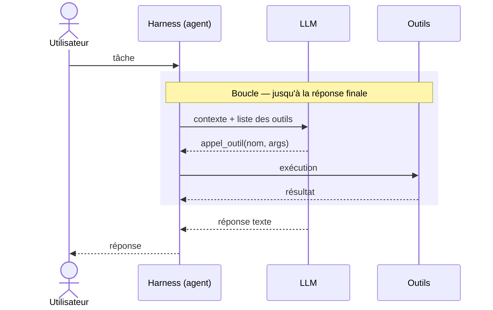
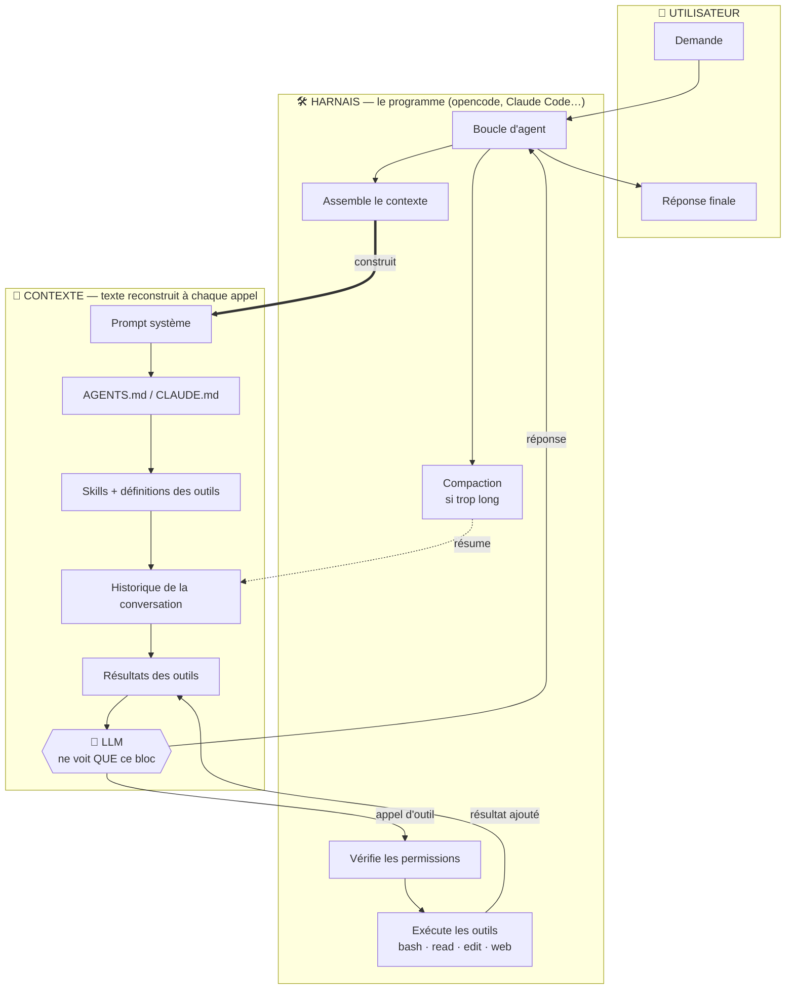

Nous allons développer une application en utilisant des outils internes qui seront utilisés pour l'exécution. Certaines tâches peuvent être demandées via un chat indépendant gratuit. 
# Prérequis 
#généraliste 
Pour réaliser ce tp, il faut vous connecter à un environnement opencode. Il existe deux alternatives : 
 - Passer par un ssh vers la machine d'accès, qui s'accède via le vpn INSA
 - Passer par une machine du `opencode` du bureau virtuel.

Si vous faites un ssh à partir de votre machine vous pouvez utiliser le terminal natif proposé par vos environnements MacOs, Linux ou Windows. Pour Windows il faut également vérifier que la commande ssh est autorisée : Paramètres → Système → Fonctionnalités facultatives → "Client openssh".

#informaticien
Pour les informaticiens vous pouvez accéder à opencode via votre application de codage comme vscode. 
# Identification des outils utilisés
- Quel est votre outil de chat "classique"
- Avez vous accès à un LLM souverain ? (via une clé API ou un accès modèle direct)
- Quel CLI utilisez vous ? (PI, opencode, claudecode, qwen code...)

# Préparation de la structure de développement
Une des difficultés initiale est de comprendre le rôle et la manière d'interagir initialement avec un LLM. Chaque interaction modélise un niveau d'interaction spécifique. On distingue actuellement 4 niveaux qui vont évoluer.

1.  Prompt : Je pose une question via un chat sur un LLM. 
2.  Prompt engineering : Je structure ma question afin que la réponse soit mieux travaillée. 
3. Rag : Ma question est accompagnée d'une information spécifique provenant de ma documentation interne
4. Harness / Context engineering : Ma question devient complexe et la solution déclenche une série d'aller/retour entre moi et la machine. 

Ici s'oppose deux visions extrêmes pour la recherche  de solutions : 
 - L'approche agile consiste à lancer un dialogue avec une interface web, de faire une série de questions/réponses pour converger vers la solution souhaitée. 
 - L'approche ingénierie consiste à préparer une série de documents en amont puis de les confronter au raisonnement du système d'IA pour obtenir une solution.
#tous
### Différences
- L'approche agile, permet de corriger au fil de l'évolution les éléments. Elle permet également de suivre le raisonnement du moteur.
- L'approche ingénierie permet une reproductibilité des résultats. Par exemple pour essayer différentes solutions à une problématique générique. 
### Démarche
- Pour une solution de prototypage ou de création d'un document ou d'une solution ponctuelle, on choisira l'approche Agile. 
- Pour standardiser un projet de production, une démarche d'ingénierie est obligatoire. 
- Dans un cours de 4séances, on déroulera une approche agile, en essayant de préciser les éléments d'ingénierie quand cela est possible.

Bien évidemment toutes les solutions intermédiaires de documentation partielle sont valides, et les évolutions des LLM ne permettent pas de stabiliser une approche plus qu'une autre. 
# Installation d'opencode
cf site web

# Description d'un CLI comme opencode
Un CLI (Commande Line Interface) ou TUI (Terminal User Interface), est un interpréteur de commandes qui sont transmises via un terminal de votre machine. Vous lancez la commande `opencode` ou `claude` dans votre fenêtre.  

![[Capture d’écran 2026-11-19 à 11.26.11.png]]

Cette fenêtre est un strict équivalent à votre `shell` de commande qui interagit avec votre système d'exploitation local, sauf que ce `shell`ci va interagir avec votre LLM  préféré et éventuellement avec votre système d'exploitation. C'est un agent qui va `boucler` sur la boucle d'action suivante : 


Il est important de noter que la réponse finale peut arriver tout de suite, comme lorsqu'on interroge un moteur de recherche ou qu'on se focalise sur une approche `prompt`.

```
        ┌──────────────┐
        │  Demande     │
        └──────┬───────┘
               ▼
   ┌──────────────────────┐
   │ LLM : raisonne       │◄─────────────┐
   └──────┬───────────────┘              │
          │                              │
   outil ?├── non ──► Réponse finale     │
          │ oui                          │
          ▼                              │
   ┌──────────────────────┐              │
   │ Exécute l'outil      │              │
   └──────┬───────────────┘              │
          ▼                              │
   ┌──────────────────────┐              │
   │ Observation → contexte├─────────────┘
   └──────────────────────┘
```

Cette boucle d'action est le point clé de la programmation agentique. Elle est entièrement pilotable, pilotée, configurable et autonome. Il est impossible d'en donner un comportement exact et formel, car son déclenchement dépend de votre `demande initiale` et du moteur LLM utilisé. Elle est subie. 

## Entrons dans le détail des choses cachées
La demande utilisateur n'est pas si directe que cela, elle est accompagnée d'informations ajoutées par le CLI local. Cela s'appelle un *Harnais* pour le CLI, et un *Contexte* pour le LLM. La différence entre les deux concepts est que le `Harnais` est normalement peuplé des intentions de l'utilisateur et du CLI, alors que le `contexte`est peuplé de l'historique des interactions avec le LLM. Le harnais est quasiment fixe, le `contexte` ne cesse de grossir. Le harnais se pilote et se configure le `contexte` est subi. 



Tu peux ajouter ce tableau sous le schéma :

|                     | **Harnais**                                                   | **Contexte**                                  |
| ------------------- | ------------------------------------------------------------- | --------------------------------------------- |
| Nature              | Du code qui tourne sur ta machine                             | Du texte (des tokens)                         |
| Durée de vie        | Toute la session                                              | Reconstruit à chaque appel au LLM             |
| Rôle                | Décide quoi envoyer, exécute les actions, applique les règles | Ce que le modèle « sait » à cet instant       |
| Limite              | Ce que le programme sait faire                                | La taille de la fenêtre (ex. 110k tokens)     |
| Exemples            | opencode, Claude Code, pi, LiteLLM (pour la passerelle)       | AGENTS.md, historique, sortie de `ls`         |
| Tu agis dessus via… | Config, plugins, agents, permissions                          | Ce que tu écris, les fichiers lus, `/compact` |

À retenir : le modèle n'agit jamais lui-même. C'est le harnais qui exécute les outils et réinjecte leurs résultats dans le contexte. Changer de harnais avec le même modèle change donc le résultat. Un bon AGENTS.md améliore le contexte, mais il ne change rien au harnais.


Pour comprendre cette différence, faite l'expérience comparative suivante :
- Créez un répertoire vide, `mkdir test1` dans lequel vous lancez `opencode`. Puis lancez une discussion avec le LLM connecté. "Bonjour, qui es-tu ?". Une fois la réponse obtenue, lancez la commande /export
- Dans une autre session, 'mkdir test2', écrivez dans un fichier le même prompt : echo "Bonjour, qui es-tu" > greeting.md. Lancez opencode, puis tapez la commande @greeting.md. Si vous exportez la session vous verrez qu'elle devient plus dense. 

# Les briques de construction d'opencode
## 1 La boucle agentique
Elle tourne avec un agent principal dans votre prompt. Elle peut être lancée sans prompt (headless) avec la commande `opencode run`. Elle peut, elle même lancer plusieurs agents qui s'occuperont de différentes tâches `Lance 3 agents, pour vérifier le prix des yaourts sur achant, leclerc et intermarché`.

De plus il existe deux agents (comportement d'agents) de base. Le mode/agent plan, qui prépare les configuration avant d'exécuter

## 2 Les outils et les environnements d'exécution
Dans le retour de la boucle agentique, le LLM demande implicitement le déclenchement d'action de la part du CLI. Le nombre d'action est limité car il n'est pas nécessaire de savoir faire beaucoup de choses pour pouvoir tout faire. 
Avant de passer à la suite, essayer d'imaginer les actions minimales dont vous avez besoin pour travailler avec un ordinateur ?

> [!question]- Qu'elles sont les fonctions fondamentalement nécessaire pour interagir avec un OS ?
> Ceci est l'exemple sur ma machine !
> 
>| Outil | Catégorie | Rôle | Statut (agent `build`) |
|---|---|---|---|
| `read` | Fichiers | Lire un fichier | ✅ autorisé (⚠️ `*.env` : demande) |
| `edit` | Fichiers | Modifier ou créer un fichier | ✅ autorisé |
| `glob` | Recherche | Trouver des fichiers par motif (`**/*.py`) | ✅ autorisé |
| `grep` | Recherche | Chercher dans le contenu des fichiers | ✅ autorisé |
| `shell` | Exécution | Exécuter une commande bash | ✅ autorisé (⛔ `python*`, `pip*`, `uv *`, `pytest*`, `ipython*`) |
| `webfetch` | Web | Lire une page web | ✅ autorisé |
| `websearch` | Web | Faire une recherche web | ✅ autorisé |
| `browser` | Web | Piloter un navigateur | ⛔ interdit |
| `todowrite` | Organisation | Écrire la liste de tâches de la session | ✅ autorisé |
| `todoread` | Organisation | Lire la liste de tâches | ✅ autorisé |
| `question` | Interaction | Poser une question à l'utilisateur | ✅ autorisé |
| `skill` | Extension | Charger une skill | ✅ autorisé |
| `subagent` | Délégation | Déléguer à un sous-agent (`explore`, `general`…) | ✅ autorisé |
| `external_directory` | Permission | Accès aux fichiers hors du projet | ✅ autorisé |

En plus des condition basiques, il existe plusieurs mécanismes d'extension comme les skills, les MCP, les sous-agents spécialisés ou les plugins. Il est difficile d'identifier quel est le meilleur outil à utiliser car le vocabulaire n'est pas homogène et encore moins normalisé. Mais vous pouvez demander à votre LLM préféré... 

Un exemple de scénario plausible d'extension est de déporter certaines activités sur une machine tierce dédiée qui héberge un outil particulier par exemple. Nous y reviendrons plus tard.
## 3 La gestion du contexte
Le contexte est cette zone de rappelle que le harnais transmet au LLM à chaque prompt. Cette zone est complétée des nouveaux faits significatifs. La taille du contexte est directement relié à un coup de session de l'utilisateur. Le contexte s'ajoute à l'empreinte mémoire du LLM nécessaire pour fabriquer une réponse. Pour des questions d'efficacités, le contexte peut être mis en cache sur le serveur afin de ne pas le recharger à chaque prompt. La taille de la fenêtre de contexte est une donnée très impactante dans les capacités de raisonnement des LLM. Par exemple Qwent:3.8:27B avec un contexte de 110k token permet à chaque requête de spécifier un document d'environ 230 pages.  Le tableau suivant vous donne un ordre de grandeur entre claude/opus et qwent.

### Claude vs Qwen — fenêtre de contexte

| | **Claude (Opus 5.5)** | **ll-qwen3.8:27b-mlx**                                        |
|---|---|---|
| Harnais | Claude Code | opencode                                                      |
| Fenêtre de contexte | **1 000 000 tokens** | **262 144** max (modèle) — **110 000** déclarés dans opencode |
| En pages de livre (~300 mots) | **~2 200 pages** | ~600 (max) — **~230** (limite opencode)                       |
| En pages Word (~500 mots) | ~1 300 pages | ~140 pages (limite opencode)                                  |
| Réservé avant la conversation | ~31k (prompt, outils, skills, MCP) | ~10–20k (prompt, outils, AGENTS.md)                           |
| Marge de compaction / sortie | 33k (autocompact) | 8 192 (sortie max)                                            |
| Taille du modèle | non publiée | 27,8 milliards de paramètres, NVFP4 (4 bits)                  |
| Où il tourne | Cloud Anthropic | Local : Mac Studio M2 Ultra, 192 Go via LiteLLM               |
| Coût | Payant | Gratuit (hors électricité)                                    |
| Confidentialité | Données envoyées à Anthropic | Rien ne sort du réseau INSA                                   |

### Occupation actuelle de la session Claude (`/context`)

| Catégorie | Tokens | % |
|---|---|---|
| Prompt système | 3k | 0,3 % |
| Outils système | 18,3k | 1,8 % |
| Outils différés (système + MCP) | 30,2k | 3,0 % |
| Skills | 6,2k | 0,6 % |
| Instructions MCP | 0,7k | 0,1 % |
| Messages (la conversation) | 122,4k | 12,2 % |
| Marge d'autocompaction | 33k | 3,3 % |
| **Espace libre** | **816,4k** | **81,6 %** |
| **Total utilisé** | **150,7k / 1M** | **15 %** |

> [!info] Repères de conversion
> - 1 token ≈ 0,65 mot en français ≈ 3,8 caractères
> - 1 page de livre ≈ 300 mots · 1 page Word ≈ 500 mots · 1 feuillet = 1 500 signes
> - Les tokenizers diffèrent d'un modèle à l'autre : ce sont des ordres de grandeur

Le fichier AGENTS.md, pilote ce contexte. Il indique les informations pertinentes et déclenche certaines actions. Le contexte est 'purgé' lorsqu'une limite de taille est atteinte. Lors d'un compactage la fenêtre va être réduite à une taille. Cette opération perds une partie de l'information précédente. Le compactage peut être problématique sur certains modèles. 

Le contexte peut également être manipulé par des instructions dans les fichiers de configurations du CLI. Certaines actions peuvent déclencher la création d'une information qui sera ajoutée au contexte. 

## 4 Mémoire et état
Mémoriser une discussion consiste à conserver le contexte et un espace de stockage contenant les données persistantes. Lorsque opencode est lancé, il démarre une tâche de fond associée à une base de données qui contient toutes les données des sessions de discussions. Une session de discussion est liée à un harnais spécifique et un contexte courant. Elle est manipulée avec les instructions : '/resume', '/sessions', '/fork', '/clear'.

## 5 Permissions
A chaque action locale, l'agent a des droits spécifiques. 'Allow', 'ask' and 'deny'. Le status dans la description des outils indique l'état de ces droits.

## 6 Vérification et retours
Les changements peuvent être annulés ou refait avec les commandes `/undo` et `/redo`. 

## 7 Orchestration
Se fait avec les agents. 
Un agent `explore` permet de faire une analyse de code ou d'un repertoire pour faire une analyse sur différents niveau de profondeur `quick, medium, thorough`.
L'agent `general` peut lancer d'autres agents. Il est possible de changer d'agent avec la combinaison `shift + tab`.
> [!question]- Réaliser un sous agent d'exécution de code distant. Par exemple exécuter du code python sur une autre machine. 
> Indique moi un squelette de code pour exécuter un code python sur une machine distante. J'indiquerai le nom de la machine dans le fichier de description de l'agent. 


> [!question]-
fabrique un fichier agent qui décrit un sous-agent d'exploration de page web. qui fonctionne avec le                                      
  ┃  modele litellm/ll_wired-qwen3.5:0.8b.  

